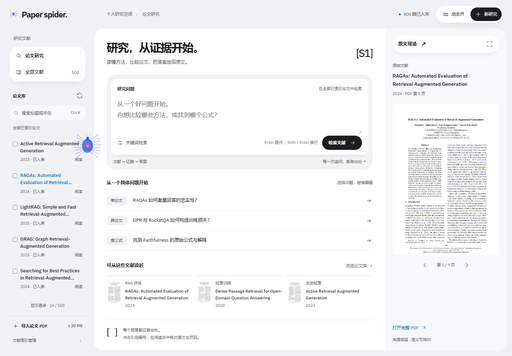
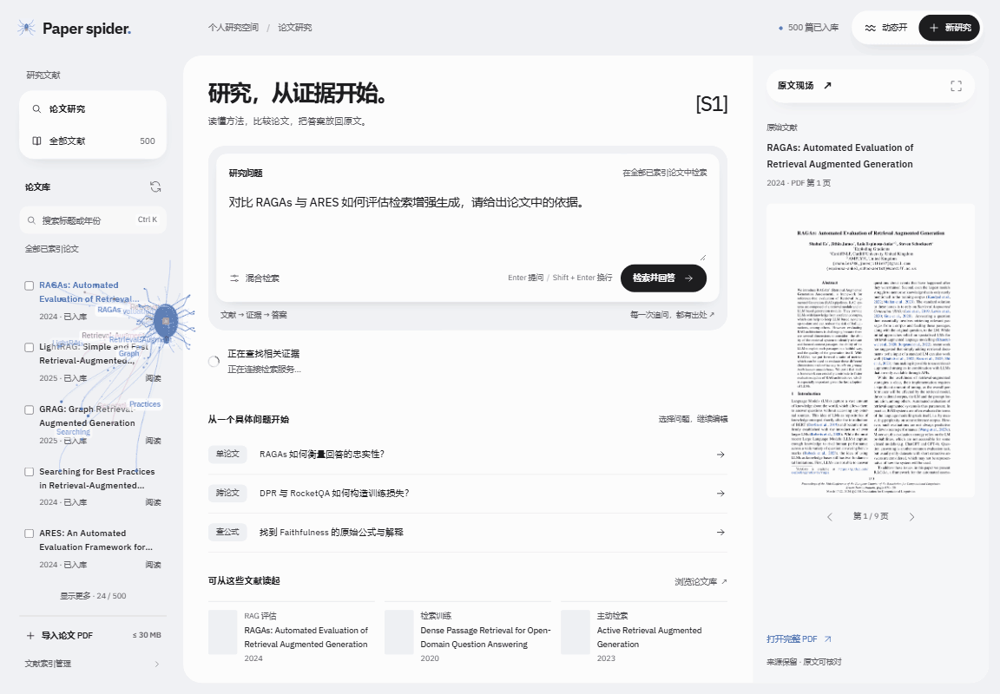
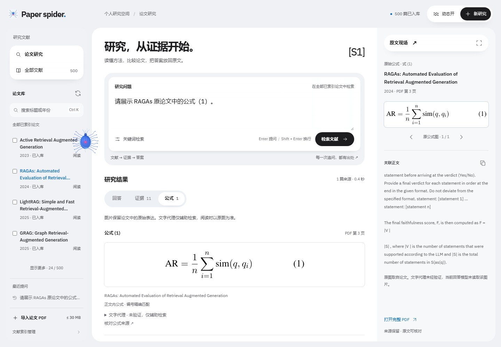
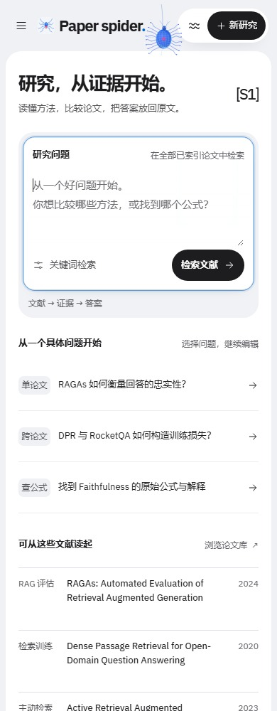
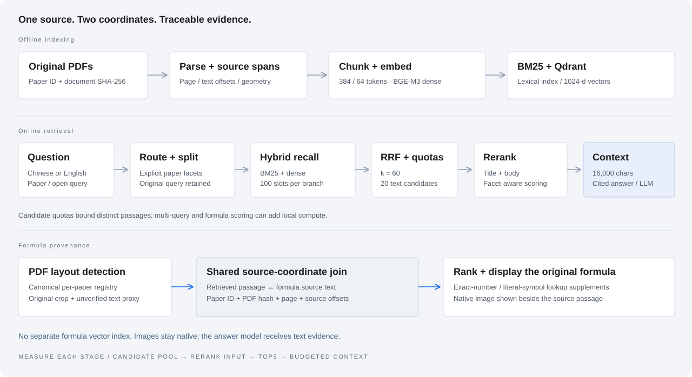

  <picture>
    <source media="(max-width: 640px)" srcset="docs/assets/cover-mobile.svg">
    
  </picture>

<strong>面向科研论文的 RAG 工作台，让回答、证据与原始公式在同一处相遇。</strong>

Hybrid retrieval. Cross-paper evidence. Original formula images.

  
  
  
  

  <a href="#工作台">工作台</a> ·
  <a href="#检索设计">检索设计</a> ·
  <a href="#评测结果">评测结果</a> ·
  <a href="#本地运行">本地运行</a> ·
  <a href="docs/architecture.md">架构</a> ·
  <a href="docs/evaluation.md">评测说明</a>

Paper spider 将研究问题连接到论文中的原始段落与公式。指定论文时缩小检索范围，跨论文比较时分别组织证据；通过混合召回与重排筛选上下文，生成带来源引用的回答，并在阅读台中核对原文。

已验证语料包含 **500 篇论文、31,037 个文本块、4,473 个公式候选**。仓库提供代码、来源清单、评测标注与运行摘要；PDF、模型与索引在本地恢复和构建。

## 工作台

文献库、问答与原文阅读三栏联动。点击引用回到对应 PDF 页面，点击公式查看原始裁剪；移动端通过抽屉与阅读视图切换。

### 一只在文献间工作的蜘蛛

等待检索时，蓝色蜘蛛沿论文栏爬行，文献列表随之滚动；空闲时悬停在界面边缘。它是等待过程的视觉反馈，由前端加载状态驱动，不表示实际检索轨迹。支持减少动态效果设置。

<strong>查看公式原图与移动端</strong>

公式原图、文字代理与来源正文分开呈现，原始 PDF 裁剪保留可核对的数学结构。

## 检索设计

**从词项与语义两路找证据。** BM25 与 BGE-M3 dense 并列召回，RRF 融合排名，再由 BGE-Reranker-v2-M3 对「问题 × 论文标题 + 正文」联合评分。中文查询采用 bigram 与科研术语中英扩展，向量由 Qdrant 存储和过滤。

**按问题决定论文范围。** 单篇且无歧义的问题在该论文内检索；明确涉及多篇论文时，保留原问题并构造按论文约束的子查询，为各篇论文预留候选名额。全部重排候选参与 **16,000 字符**上下文预算筛选，Top5 用于排序诊断。

**复用正文索引找公式。** 正文块与公式共享来源字符坐标，检索命中正文后联接相关公式，补充单论文编号查找和符号匹配。无需另建公式向量索引。原图负责展示，未经验证的文字代理用于匹配；当前回答模型不读取公式图片。

**每条证据都能回到来源。** 论文 ID、PDF 哈希、物理页码、字符范围与页面坐标共同保存来源。引用编号检查覆盖 ID 与清单一致性，事实支持仍需核对引用原文。

| 环节 | 实现 |
| --- | --- |
| 文档与分块 | PyMuPDF；384 / 64 token 固定窗口；独立结构分块实验配置 |
| 检索 | BM25、BGE-M3 1024 维 dense、Qdrant、RRF k=60 |
| 候选与重排 | 每路总召回名额 100；20 个不同正文候选；标题增强 Cross-Encoder |
| 论文组织 | 保守路由、明确论文实体拆解、跨论文候选配额 |
| 公式来源 | 规则检测、原始裁剪、坐标联接、编号查找与候选排序 |
| 生成与界面 | DeepSeek 兼容 API、来源引用；FastAPI + 原生 HTML / CSS / JavaScript |

机制与边界见 [技术设计](docs/architecture.md)。

## 评测结果

文本和公式各有一套 **50 题检验集**，包含单论文、跨论文、开放式问题与控制题。标注锚定原始来源，分阶段记录候选、重排及预算上下文的覆盖，定位证据损失。

**公式检索：同一套 50 题中的 35 道语义题。**

| 指标 | V1 | V2 |
| --- | ---: | ---: |
| 最终上下文：公式锚点平均召回率 | 62.9% | **77.1%** |
| 全部必要公式均召回的问题比例 | 62.9% | **74.3%** |
| 其中 5 道跨论文题：公式锚点平均召回率 | 0.0% | **60.0%** |
| 编号 / 符号查询：全部目标齐全 | 11 / 11 | **11 / 11** |
| 检索控制项通过 | 3 / 4 | **4 / 4** |

公式锚点召回率先按题计算命中的必要公式组比例，再对题目求平均；“全部齐全”要求一道题的所有必要组均命中。V1 / V2 为包含查询处理、排序及预算变化的**整体配置对照**，不是单模块消融，也不是问答准确率。标注尚未完成独立人工复核。

<strong>文本 V1 基线与结果记录</strong>

文本 50 题中 46 题可回答。旧版固定窗口基线采用固定英文 BM25 等义查询、每路 100 条、20 条重排候选与 8,000 字符预算。

| 阶段 | 必要证据单元平均召回率 |
| --- | ---: |
| 双路候选池 | 92.3% |
| 融合后前 20 条 | 79.5% |
| 重排前 5 条 | 67.4% |
| 最终预算上下文 | 59.4% |

文本证据与公式锚点评分对象不同，不能混用。候选抽样也不衡量完整公式检测召回率。详细定义、配置指纹与复现条件见 [评测说明](docs/evaluation.md)，原始运行摘要见 [docs/benchmarks/](docs/benchmarks/)。

## 本地运行

推荐 Python 3.12。以下使用 Windows / PowerShell 与已验证的 CUDA 12.4 依赖；CPU、Linux 与完整建库步骤见 [运行指南](docs/getting-started.md)。

~~~powershell
git clone https://github.com/lansunny/paper-spider.git
cd paper-spider
python -m venv .venv-rag
.\.venv-rag\Scripts\Activate.ps1
python -m pip install -r requirements.txt
docker compose up -d qdrant

# 恢复论文并校验来源，准备模型与向量索引
python scripts/restore_paper_corpus.py --download
python main.py --task models --config configs/retrieval_v2.json
python main.py --task index --config configs/retrieval_v2.json
python scripts/extract_all_formulas.py

python main.py
~~~

打开 **http://127.0.0.1:8765**。首次运行需要下载 PDF 和模型，并完成建库。

生成回答时，将 [.env.example](.env.example) 复制为 `.env`，填写 `DEEPSEEK_API_KEY`，按服务可用性设置 `DEEPSEEK_MODEL_ID`。检索与公式抽取无需生成 API 密钥。

### 运行检验

~~~powershell
python scripts/prepare_formula_test50.py
python scripts/test_formula_retrieval50.py --validate-only
python scripts/test_formula_retrieval50.py --profile v2 --limit 3
python scripts/test_formula_retrieval50.py --profile v2
python -m unittest discover -s tests -v
~~~

公式检验不生成回答。离线单元测试使用合成样例与模拟接口；真实数据库集成测试需单独启用。消融开关与比较条件见 [评测说明](docs/evaluation.md#重跑与消融)。

## 源码导航

| 入口 | 内容 |
| --- | --- |
| [rag/pipeline_v2.py](rag/pipeline_v2.py) | 检索编排、阶段记录与预算上下文 |
| [rag/query_planning_v2.py](rag/query_planning_v2.py) | 论文路由、子查询与配额 |
| [rag/lexical_v2.py](rag/lexical_v2.py) | 中文 bigram 与科研术语扩展 |
| [rag/vector_store.py](rag/vector_store.py) | Qdrant、论文过滤与 snapshot 隔离 |
| [rag/formula_retrieval_v2.py](rag/formula_retrieval_v2.py) | 公式来源联接、检索与排序 |
| [rag/formula_store.py](rag/formula_store.py) | 完整抽取产物与来源完整性 |
| [backend/](backend/) · [frontend/](frontend/) | 本地服务、文献库、问答与阅读台 |
| [configs/](configs/) · [data/evaluation/](data/evaluation/) | 检索配置与固定评测标注 |

## 数据与许可

源代码采用 [Apache-2.0](LICENSE) 许可。论文、模型、字体与第三方组件遵循各自许可；论文清单保留作者、来源 URL 与文件哈希。数据准备见 [数据说明](docs/data.md)，组件及视觉交互来源见 [第三方声明](THIRD_PARTY_NOTICES.md)。
