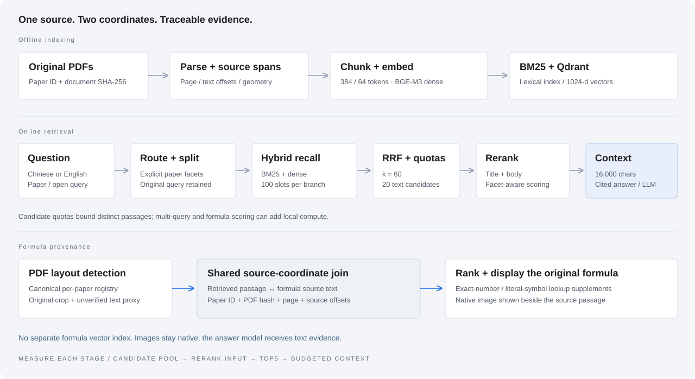

# 技术设计

## 文档表示与来源

清单保存论文身份、原始 URL 与 PDF SHA-256。PyMuPDF 提取原生文本块、物理页码和几何位置。固定窗口配置为 384 token、64 token overlap；结构分块为独立实验配置。

正文由 BGE-M3 编码为 1024 维 dense 向量并归一化，当前采用 CLS pooling。Qdrant 保存命名向量、论文身份、来源哈希和 snapshot；查询条件限定语料版本与论文范围。

索引检查模型 revision、维度、分块版本和来源规范，避免混用不兼容表示。HNSW 配置不意味着每次查询使用相同搜索计划，过滤规模与数据库优化也会影响执行。

入口：[ingestion.py](../rag/ingestion.py)、[schema.py](../rag/schema.py)、[embeddings.py](../rag/embeddings.py)、[vector_store.py](../rag/vector_store.py)。

## V2 查询与候选组织

1. 匹配完整标题、论文 ID 与别名。单篇且无歧义的问题可限定论文；开放式或比较意图保留全库能力。
2. 对明确提及多篇论文的问题，构造最多三条按论文约束的子查询，同时保留原问题检索。默认采用确定性规则，不调用大模型规划。
3. BM25 与 Dense 并列召回。每路默认总名额为 100；多查询时原问题获得约一半，其余分配给子查询。
4. 使用 RRF 融合排名。正文重排保留 20 个不同候选，为论文子问题分配名额。
5. 对跨论文公式请求，先排序已由候选正文联接的公式，可将相关公式对应的少量来源块保留在重排集合内。
6. Cross-Encoder 对原问题和对应论文子问题评分，以排名融合组织候选。
7. 全部重排候选参与预算选择，保留完整块并去除完全重复正文。

名额相同不代表计算量相同：多查询增加编码、检索和配对评分。结果记录查询数、候选数、正文评分对数、公式评分量及阶段耗时。

| 默认值 | 含义 |
| --- | --- |
| candidate_k = 100 | 每路分配的总召回名额 |
| rrf_k = 60 | 名次贡献的平滑参数 |
| rerank_k = 20 | 不同正文重排候选数，受调用 Top-K 下限约束 |
| Top5 | 排序诊断视图；实际上下文不固定只取五条 |
| context_char_budget = 16000 | 序列化证据字符预算，不等于模型 token 预算 |

中文 BM25 使用 bigram 与通用科研术语中英词表扩展，属于词汇桥接。词法索引用标题、章节与正文评分，返回的证据正文保持原样。

入口：[pipeline_v2.py](../rag/pipeline_v2.py)、[query_planning_v2.py](../rag/query_planning_v2.py)、[lexical_v2.py](../rag/lexical_v2.py)、[facet_reranking.py](../rag/facet_reranking.py)。

## 标题增强与重排

论文过滤决定候选资格；标题增强补充评分输入；Cross-Encoder 联合计算问题与文本的相关性。

模型评分输入为「Title + Text」，返回时恢复原正文，以保持引用和坐标一致。当前返回原始评分，不将其解释为正确概率。标题信息也可能抬高同论文的无关段落，效果需要分题型检验。

## 公式的两种来源坐标

- **字符坐标**：联接正文块、公式原文与相邻解释；区间使用同一页规范文本上的半开范围。
- **页面几何坐标**：在原始 PDF 中裁剪公式，并定位展示区域。

结构块的 Chunk.source_spans 与 FormulaSourceText 共用规范字符坐标。固定窗口旧块通过唯一原文精确匹配恢复区间；缺失或有歧义时不强行联接。比较区间前同时验证论文、文档哈希与页码。

原图与文字代理分开保存。默认不建立公式向量索引，回答模型也不读取图片。编号精确查找要求明确的单论文范围；符号兜底匹配字面来源。V2 在展示截断前排序，并处理缺失编号、范围不明与非公式检查意图。

runtime/formulas/CURRENT.json 指向每篇论文唯一的完整抽取产物。清单、正文坐标与图片哈希接受完整性检查；标准标注锚定原始来源，不以检测器生成的 element ID 定义答案。

入口：[formula_schema.py](../rag/formula_schema.py)、[formula_store.py](../rag/formula_store.py)、[formula_retrieval.py](../rag/formula_retrieval.py)、[formula_retrieval_v2.py](../rag/formula_retrieval_v2.py)。

## 回答与核对

选中的证据分配 S1、S2 等编号，与问题一起发送给回答模型。引用检查验证编号存在、正文引用与清单一致；断言是否被材料支持，需要进一步核对。

前端将引用映射回原始页面，公式使用原图呈现。文字代理的用途与图像是否进入回答模型明确区分。

## 当前边界

- 正文召回和坐标联接都可能遗漏公式，候选抽样检验不能测量完整检测召回率。
- 视觉公式理解、可靠 LaTeX 转写和推导验证尚未完成。
- 结构分块配置还存在候选数量和预算差异，结果不能自动归因于分块方法。
- 更大独立检验集、断言级引用评估和成本约束下的参数选择仍有优化空间。

回到 [项目首页](../README.md)。

